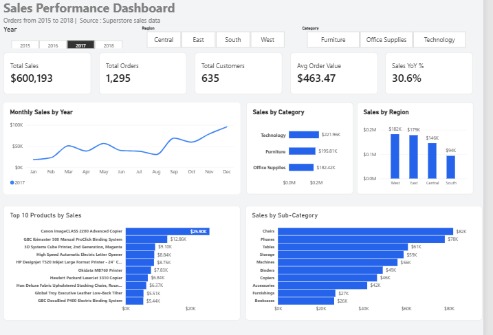

# Retail Sales Performance Dashboard (Power BI)

Interactive Power BI dashboard analysing retail sales from 2015 to 2018.

## Business problem
A retail manager needs to understand how sales change over time and
which regions, categories and products drive revenue.

## Data
Superstore sales data: 9,800 rows, reduced to 9,799 after cleaning.

## What I did
- Cleaned the data in Power Query: converted day/month dates, removed
  one duplicate row, filled missing postal codes, trimmed and
  standardised text
- Built a Calendar table and a relationship for time analysis
- Wrote DAX measures: Total Sales, Total Orders, Total Customers,
  Average Order Value and Year-over-Year growth
- Designed an interactive dashboard with Year, Region and Category
  slicers, KPI cards, a monthly trend, category and region charts
  and a Top 10 products chart
- Validated Total Sales against the source file ($2,261,255 after
  removing one duplicate row)

## Key insights
- Sales fell about 4% in 2016, then grew about 31% in 2017 and 20% in 2018
- Orders grew from 947 in 2015 to 1,661 in 2018, so growth comes from
  more orders, not bigger ones
- Sales peak in September, November and December and are lowest in
  January and February
- West and East bring in about 61% of sales; South is the weakest region
- Technology is the top category ($827K)
- The Canon imageCLASS 2200 copier is the top product ($61.6K)

## Recommendations
- Stock up and promote ahead of the autumn peak
- Investigate why the South region lags
- Raise order size with bundles and upsells

## Limitation
The data has no profit column, so the analysis covers sales, not profitability.

## With a year selected (2017)

## Tools
Power BI, Power Query, DAX, Excel

## Files
- sales Dashboard Final.pbix: Power BI source file (download and open in Power BI Desktop)
